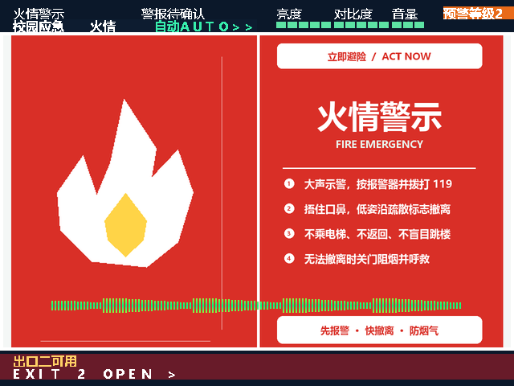
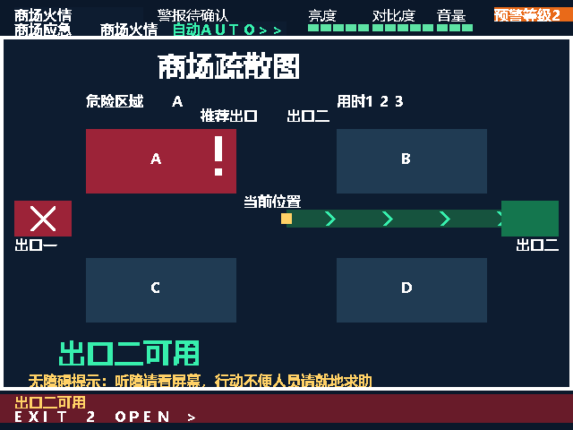
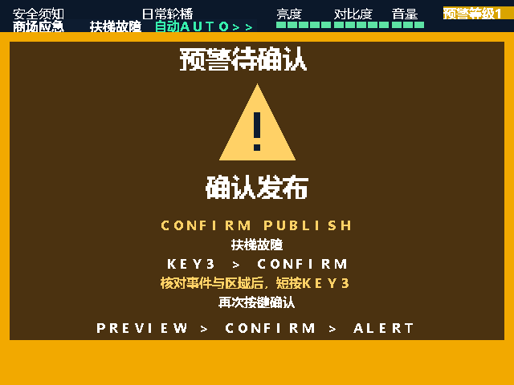
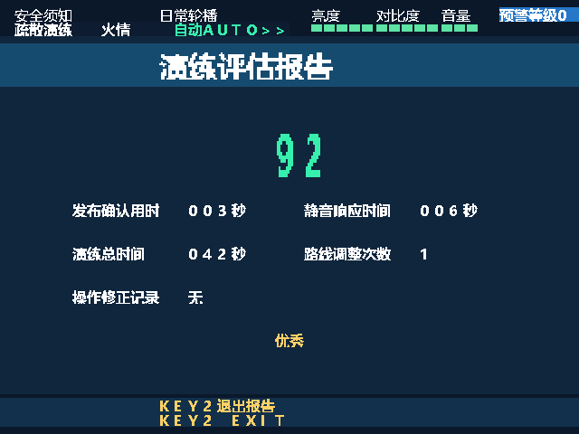

# 智域安澜 · 多场景应急信息发布与疏散引导终端

基于安路 **EG4S20BG256（HX4S20C 开发板）** 的 FPGA 竞赛作品。通过板载按键、拨码开关、TF 卡和 HDMI 显示器，完成日常信息展示、应急发布、动态疏散引导与演练记录，无需软核 CPU 或操作系统。

当前交付版本：`20261101_212706`，显示器接 **HDMI_B**。本仓库整理了可复现工程、配套位流、TF 卡素材、测试与实现报告。

## 界面预览

下列图片为工程界面预览，实板效果以实际烧录结果为准。

| 校园应急 | 商场应急 |
| --- | --- |
|  |  |
|  |  |

## 功能

- **基础显示与播放**：FAT32 文件读取、BMP 解码与尺寸适配、SDRAM 帧缓存、640×480 HDMI 输出、自动/手动轮播、字幕、切换特效、亮度/对比度调节及 OSD。
- **音频**：TF 卡 PCM 播放、HDMI 音频输出、五档音量、独立静音与音频幅度可视化；火情、地震、洪涝使用配套中文播报。
- **三个场景**：校园应急、疏散演练、商场应急。校园/演练事件为火情、地震、洪涝、疏散；商场事件为火情、人员拥挤、停电、扶梯故障。
- **疏散与无障碍提示**：四区危险模拟、左右半区/全区报警、双出口状态、动态箭头、中英文及图标同时表达，静音后保留闪烁边框等视觉提示。
- **操作保护与记录**：发布/解除二次确认、正式应急路线变更确认、预警等级、状态页、四条易失事件记录与演练报告。
- **可配置预案与故障恢复**：通过 `PLAN.BIN` 配置轮播时间等参数；素材校验失败时显示内置图形、使用片上警报，并周期重试 TF 初始化。

商场火情使用火情中文播报，其他三种商场事件使用通用警报与对应屏幕提示，未提供专属中文语音。

## 文件结构

```text
.
├── README.md                         项目首页
├── THIRD_PARTY_NOTICES.md             依赖与素材权利说明
├── README_V2_使用说明.md              详细操作说明
├── 验证记录_V2.md                    交付验证记录
├── emergency_terminal_v2_hdmi_b.bit  配套烧录文件
├── release_manifest_v2.json          交付版本与文件校验信息
├── TF_CARD_ROOT/                     直接复制到 TF 卡根目录的 11 个文件
├── previews/                         界面预览
└── portable_project/
    ├── project/emergency_terminal.al 唐朝工程入口
    ├── src/                         终端 RTL
    ├── constraints/                 引脚与时序约束
    ├── dependencies/                工程所需参考模块、厂商 IP
    ├── sim/                         仿真测试
    ├── reports/                     测试、资源及时序报告
    ├── config/                      预案配置模板
    ├── tools/                       重建、测试与预案生成工具
    ├── assets/                      辅助资源
    ├── TF_CARD_ROOT/                自包含工程配套素材
    └── previews/                    自包含工程预览
```

`portable_project` 保留了完整相对路径；不要扁平化、重命名内部依赖目录或单独移动 `.al` 文件。工程内重复的素材用于保证源码目录自包含。

## 快速上板

1. 准备 HX4S20C 开发板、FAT32 格式 TF 卡、HDMI 线和支持 HDMI 音频的显示设备。
2. 将根目录 `TF_CARD_ROOT` 内 **11 个文件**复制到 TF 卡根目录，保持文件名不变，安全弹出 TF 卡。
3. 显示器接 **HDMI_B**；在下载工具中选配置 Flash，烧录根目录的 `.bit` 文件。
4. 断电，插好 TF 卡，SW1～SW4 先置低，再上电。后台会继续加载素材，可从状态页查看加载情况。
5. 使用下表操作。仅下载到 SRAM 时，断电不会保留 FPGA 配置。

图片与音频校验常量和本版位流绑定，不能随意替换素材后继续使用旧位流；更换媒体需要同步更新校验常量并重新构建。修改合法的 `PLAN.BIN` 参数不需要重新综合。

## 按键与拨码

长按约一秒，短按在松开时执行；双键短按需接近同时按下后松开。

| 操作 | 正常状态 | 应急状态 |
| --- | --- | --- |
| KEY1 | 全局复位、清空易失记录 | 相同 |
| KEY2 短按 | 切换 NORMAL / SAFETY | 切换应急内容页 / 动态疏散图 |
| KEY2 长按 | 自动 / 手动切换 | 相同 |
| KEY3 短按 | 预警确认，再按发布 | 优先确认待变更路线；否则静音 |
| KEY3 长按 | 选择当前场景事件 | 进入解除确认，再次长按解除 |
| KEY2 + KEY3 同时短按 | 切换校园 / 演练 / 商场场景 | 状态页 / 历史页 / 内容页 |
| KEY4 长按 | 选择亮度 / 对比度 / 音量 | 相同 |
| KEY4 短按 | 当前参数五档循环调节 | 相同 |
| SW1、SW2 | 选择危险区域编码 | 校园/商场变更后用 KEY3 确认路线 |
| SW3 | 选择单区或半区/全区规则 | 相同 |
| SW4 两次有效上升沿 | 第一次预警，第二次发布 | 不用于解除或静音 |

SW3=0 时，SW2/SW1 的 `00、01、10、11` 对应 A、B、C、D；SW3=1 时分别对应全部、左半区、右半区、全部。演练场景路线自动更新。

数码管从左到右依次为：状态（`d`正常/`E`应急）、事件编号、音量档位、亮度档位、对比度档位、当前调节项目（1亮度/2对比度/3音量）。详细说明见 [使用说明](README_V2_使用说明.md)。

## 构建与测试

使用 **Tang Dynasty 6.2.168116**，器件 `EG4S20BG256`，顶层 `emergency_terminal_top`。可直接打开 `portable_project/project/emergency_terminal.al`。

在仓库根目录运行以下命令；根据安装位置修改 `--td`，需要 Python 3：

```powershell
python portable_project/tools/rebuild.py --td D:/ANLUTD --seed 3
```

仿真需要 Icarus Verilog，脚本默认安装位置为 `D:/iverilog/bin`，也可通过 `-Iverilog` 和 `-Vvp` 指定：

```powershell
powershell -ExecutionPolicy Bypass -File portable_project/tools/run_tests.ps1 -Test All
```

预案配置：修改 `portable_project/config/plan_template.json`，进入 `portable_project` 后运行 `python tools/make_plan.py`。将生成的 `portable_project/TF_CARD_ROOT/PLAN.BIN` 复制到实际 TF 卡根目录；根目录另一个素材副本不会自动更新。

## 已有验证与资源

以下为交付版本保存的报告结果，本次仓库整理未重新综合或重新执行硬件测试。完整证据见 [验证记录](验证记录_V2.md) 和 [reports](portable_project/reports)。

| 项目 | 使用 / 总量 |
| --- | --- |
| LUT | 15,887 / 19,600（81.06%） |
| 寄存器 | 7,297 / 19,600（37.23%） |
| BRAM | 56 / 64（87.50%） |
| DSP | 9 / 29 |
| PLL | 2 / 4 |

保存的回归结果为 17/17 通过，建立/保持时间最差裕量分别为 +0.292 ns / +0.024 ns。软件报告不能代替实板验收；交付清单中的 `hardware_tested: false` 表示该清单生成流程未执行实板测试。

## 适用范围与许可

这是教学与竞赛原型。危险区域来自拨码模拟，地图为示意图；事件记录最多四条、计时最大 999 秒，复位或断电清空，无实时时钟与持久化日志。

当前未为整个仓库指定统一开源许可证。厂商 IP、参考模块及音频素材的权利需分别核实，详见 [第三方说明](THIRD_PARTY_NOTICES.md)。建议先私密保存；公开仓库和授予开源许可是两个不同操作。
